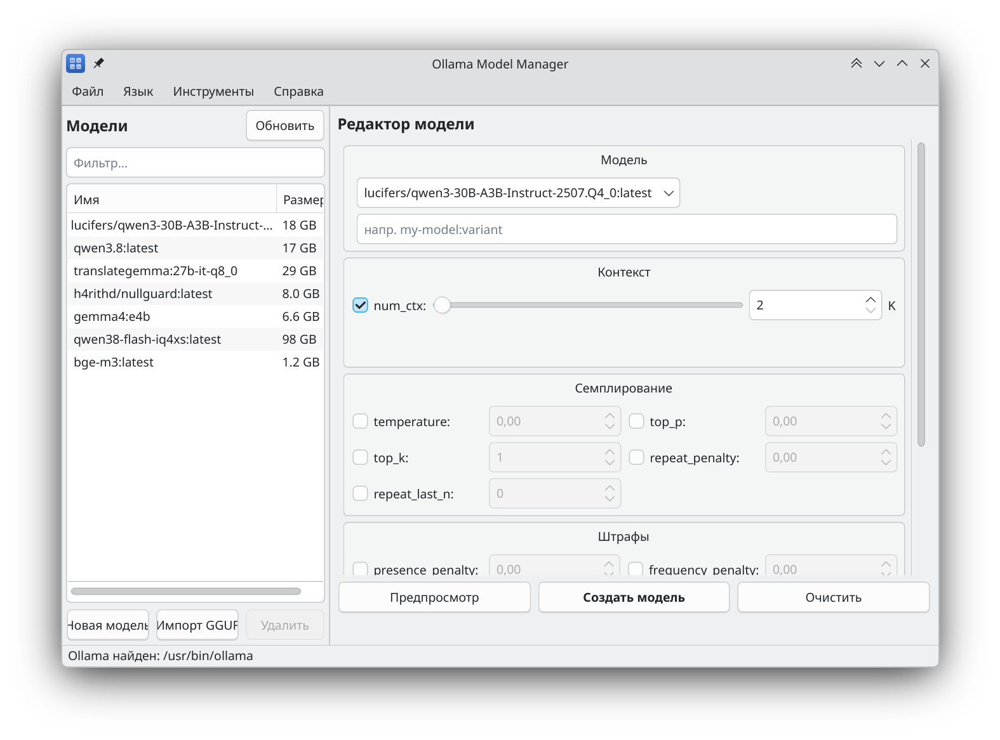
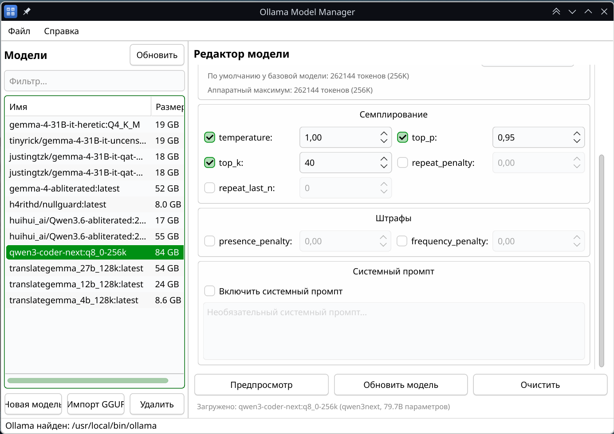
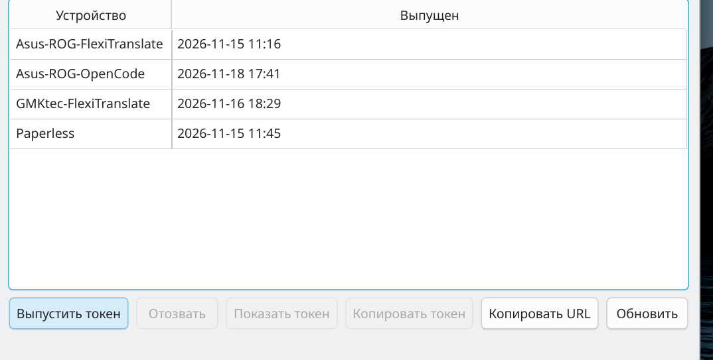
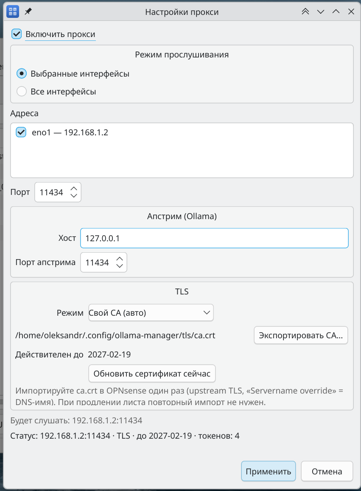

# Ollama Model Manager

A lightweight desktop GUI for managing your local [Ollama](https://ollama.com) models — built with Qt 6 and C++17.

Browse installed models, tweak their parameters (context size, sampling, penalties, system prompt), create new variants, import GGUF files, rename and delete — all without hand‑writing a single `Modelfile`.

> **Highlight:** editing a model **preserves its multimodal (vision) projector**, template, renderer and parser. Unlike a naïve `ollama create FROM /path/to/blob`, this tool rebuilds models by referencing them **by name**, so capabilities like `vision` are never silently dropped.

---

## Screenshots









---

## Features

- **Installed models as repository cards** — the *Installed* tab groups the quants of one
  repository (Ollama registry or HuggingFace) into a card; a hero strip on top shows the model
  count, RAM and the disk that really holds Ollama's blobs (`$OLLAMA_MODELS`, `/var/lib/ollama`,
  `~/.ollama/models`), and whether the Ollama daemon answers.
- **Parameter editor** with tooltips for each option:
  - `num_ctx` — entered in **K** (1K = 1024 tokens) with a slider + spinbox, hard‑capped at the model's maximum context.
  - `temperature`, `top_p`, `top_k`
  - `repeat_penalty`, `repeat_last_n`, `presence_penalty`, `frequency_penalty`
  - custom `SYSTEM` prompt (kept verbatim: blank lines and indentation survive an update)
  - other quants of the same repository in the FROM picker — install a missing one in place.
- **Create / Update models** — generate a `Modelfile` and run `ollama create` for you; preview it first.
- **Rename** (via `ollama cp` + `rm`) and **delete**, with awareness of shared weight blobs (warns before deleting the last reference).
- **Ollama tab** — search ollama.com, pick a tag (size and "fits in memory" hint), `ollama pull`
  with an aggregate progress bar; installed tags and available updates are marked.
- **HuggingFace tab** — search GGUF repositories, one entry per quantization (split GGUFs are
  merged, vision projectors are downloaded alongside), resumable downloads pinned to one commit,
  `ollama create` straight from the downloaded files, which are deleted afterwards. Gated repos
  work with a HuggingFace token kept in KDE Wallet (**Tools → HuggingFace token…**).
- **Provenance** — the manager remembers where each model came from (`models.json`), so it can
  check for updates; **Tools → Find sources** restores the link for models installed elsewhere.
- **Import GGUF** — turn a local `.gguf` file into an Ollama model.
- **Capability‑safe edits** — vision projector and template layers are inherited, not lost.
- **Themes** — system, light or dark (**View → Theme**, or `OMM_THEME=light|dark`).
- **Localization** — runtime-loaded `.ini` language files (English & Russian included); add a language by dropping a file in `languages/`.
- **API tokens + built-in auth proxy** — issue and revoke one token per device (laptop, phone, …)
  from **Tools → API tokens…** (`Ctrl+T`). Tokens live **only in KDE Wallet** and are checked by
  the proxy inside this application: they are never written to disk, and revocation takes effect
  on the very next request. Only tokens flagged **Admin** may pull, create or delete models
  through the proxy.
- **Daemon & tray** — optionally runs in the background with a tray icon, proxying Ollama on the
  LAN while the GUI window stays hidden. The proxy runs in its own thread, so dialogs and wallet
  prompts never stall remote clients. The window itself keeps repainting but does not accept
  clicks while a wallet prompt (up to 5 minutes) or the RSA key generation runs: the wait is a
  local event loop that excludes user input, not a frozen application.

---

## Requirements

- [Ollama](https://ollama.com) installed and available in `PATH`
- **Qt 6.5+** (Widgets, Core, Network; Test for the test suite)
- **KDE Frameworks 6 — KWallet** (`KF6::Wallet`, plus `extra-cmake-modules`) for the token manager
- **CMake ≥ 3.21**
- **OpenSSL** CLI (≥ 3.0) at runtime — used to generate and renew the internal CA/certificate
  (looked up in `/usr/bin`, `/bin`, `/usr/local/bin` before `PATH`)
- A C++17 compiler (GCC / Clang)

On Debian/Ubuntu:

```bash
sudo apt install build-essential cmake qt6-base-dev libkf6wallet-dev extra-cmake-modules
```

On Fedora:

```bash
sudo dnf install gcc-c++ cmake qt6-qtbase-devel kf6-kwallet-devel extra-cmake-modules
```

On Arch:

```bash
sudo pacman -S base-devel cmake qt6-base kwallet extra-cmake-modules
```

---

## Build

```bash
git clone https://github.com/ur3ley/ollama-model-manager.git
cd ollama-model-manager
cmake -B build
cmake --build build
```

The binary is produced at `build/ollama-model-manager`. Options:

| Option | Default | Meaning |
|---|---|---|
| `BUILD_TESTING` | `ON` | build the self-tests and register them with CTest |
| `OMM_DEV_TOOLS` | `OFF` | build `mainwindow-grab` (offscreen screenshots) |
| `OMM_WARNINGS_AS_ERRORS` | `OFF` | `-Werror` on top of `-Wall -Wextra -Wshadow` |

Optionally install it system‑wide (binary, languages, `.desktop` file, systemd unit under
`share/ollama-model-manager/systemd`):

```bash
sudo cmake --install build
```

---

## Usage

```bash
./build/ollama-model-manager
```

1. The *Installed* tab lists your models as cards. Select one to load its parameters into the editor.
2. Adjust parameters. Use **Preview** to see the generated `Modelfile`.
3. **Update** rebuilds the selected model in place; change the **Name** field and press **Create** to save a new variant instead.
4. The *Ollama* and *HuggingFace* tabs (`Ctrl+D` switches between them) search and install new models.
5. **Import GGUF** (`Ctrl+I`) creates a model from a local `.gguf` file.

Keyboard shortcuts: `Ctrl+N` new model · `Ctrl+I` import GGUF · `Ctrl+D` Ollama/HuggingFace tabs ·
`Ctrl+T` API tokens · `F5` refresh · `Ctrl+Q` quit.

> The interface language can be changed at runtime via the **Language** menu.

### Where the files are

| What | Path |
|---|---|
| Settings (proxy, theme, language) | `~/.config/ollama-manager/config.ini` (0600) |
| Model provenance | `~/.config/ollama-manager/models.json` |
| Proxy TLS material | `~/.config/ollama-manager/tls/` (0700) |
| Downloaded GGUF sources | `~/.local/share/ollama-manager/models` (deleted after a successful import) |
| Secrets (API tokens, HF token) | KDE Wallet `kdewallet`, folders `ollama-auth` / `ollama-model-manager` |

Versions before 2026-11-22 kept the language in `~/.config/OllamaManager/Ollama Model Manager.conf`,
`models.json` in `~/.config/OllamaManager/Ollama Model Manager/` and downloads in
`~/.local/share/OllamaManager/Ollama Model Manager/models`; they are moved on the first start.

---

## Built-in auth proxy

The manager itself can act as a token-checking reverse proxy in front of Ollama. It replaces the
earlier nginx + podman container: no Python script, no tmpfs
snippet, no container reload — tokens are read from KDE Wallet into process memory and looked up
by SHA-256, so plaintext tokens never leave the wallet.

Two listen modes (**Settings → Proxy**):

| Mode | Address | Port |
|---|---|---|
| Selected interfaces | one or more concrete interface addresses | may be the same as Ollama's (`11434`) |
| All interfaces | `0.0.0.0` | must differ from Ollama's port (default `11435`) |

The reason is a kernel rule: `0.0.0.0:P` cannot be bound while Ollama holds `127.0.0.1:P`, whereas
`192.0.2.10:P` can. Loopback is never bound, so local clients (`ollama` CLI, the manager itself)
keep talking to Ollama directly, without a token.

Daemon mode:

```bash
ollama-model-manager --daemon --listen 192.0.2.10:11434
ollama-model-manager --daemon --listen 0.0.0.0:11435
ollama-model-manager --show     # raise the window of a running instance
```

Streaming is preserved byte-for-byte (`/api/chat` NDJSON, `/v1` SSE). Full architecture, limits and
the migration/rollback procedure: [`docs/proxy.md`](docs/proxy.md).

### TLS on the internal hop

The OPNsense → host leg can be encrypted as well. The default mode is an **internal CA**:

- a 10‑year Root CA is generated once (`~/.config/ollama-manager/tls/`, mode 0700/0600);
- a 90‑day leaf certificate (`SAN IP:192.0.2.10`, `DNS:ollama.example.org`) is renewed
  automatically 30 days before expiry;
- import **only the CA** into OPNsense once (*TLS: Trusted Certificate*), leave
  *Verify Certificate* on — leaf renewals need no further imports.

Alternative modes: your own cert/key files, or a publicly trusted Let's Encrypt certificate
obtained via deSEC DNS‑01 (`lego`). Keys never leave `~/.config/ollama-manager/tls/`.

### Security

- Tokens never touch disk; they are compared as SHA-256 hashes, so a timing attack cannot
  recover them character by character.
- Request limits: 100 MiB body (counted by actual bytes, chunked included), 32 KiB and 100
  headers, 8 KiB URI, 256 connections (0 = deny all), 10 s header timeout, bidirectional
  backpressure at 4/1 MiB.
- Control characters and obs-fold are rejected; hop-by-hop headers (including those named in
  `Connection`) are stripped; device names are validated before use.
- Parser fuzzed with >4.5 million libFuzzer iterations under ASan/UBSan (zero crashes).
- A hardened systemd unit is shipped in `packaging/systemd/`.

## API tokens

| Piece | Value |
|---|---|
| Wallet | `kdewallet`, folder `ollama-auth` |
| Keys | `<device>` = token, `created:<device>` = ISO-8601 date, `admin:<device>` = `1` |
| Token format | 24 random bytes → 48 hex characters |
| Endpoint | `[proxy] public_url` in `config.ini`, e.g. `https://ollama.example.org` |

Workflow: **Tools → API tokens… → Issue token** → type a device name → the token is shown once in a
modal window (selectable, copied only by an explicit button; it never leaves the wallet in plaintext
afterwards; **Show** reveals it on demand). **Revoke** removes it from the wallet, and the device
loses access immediately. **Copy URL** puts the endpoint on the clipboard.

The **Admin** column of the dialog decides who may manage models through the proxy: with
`[proxy] admin_api = restricted` (the default) a token without it gets the client API only
(chat, generate, embeddings, model list) and `403` on `/api/pull`, `/api/create`, `/api/delete`…
Set `admin_api = open` to let every token do everything, as before.

## Testing

```bash
cmake -B build && cmake --build build
ctest --test-dir build --output-on-failure
```

15 offline tests run under CTest with an isolated `HOME` and the offscreen platform — no
network, no Ollama daemon, no KDE Wallet:

| Test | Covers |
|---|---|
| `proxy-selftest` | auth proxy: tokens, admin allow-list, header rewriting, streaming, limits, TLS |
| `ollamajobs-selftest` | `OllamaCli` jobs and `InstallService` against a fake `ollama` (queued pulls, crashes, partial rename, cleanup) |
| `hfdownload-selftest` | HuggingFace download against a local HTTP server: resume, 416, size check, revision pinning, token not sent to the CDN |
| `migration-selftest` | first-run migrations (downloads, language, `admin_api`), FROM quoting |
| `hfclient`, `hfvariants`, `registryclient` | HuggingFace / ollama.com parsers and variant grouping |
| `modelfile-parse`, `pullprogress`, `ggufmeta` | Modelfile parsing/building, pull progress, GGUF header reader |
| `provenance`, `repogroup`, `modelfilters` | `models.json`, repository cards, hub filters |
| `discoverpanel`, `ggufimportdialog` | widget smoke tests (offscreen) |

Not in CTest: `token-selftest` needs an unlocked KDE Wallet (it works in its own folder
`ollama-auth-selftest` and removes it afterwards); `discoverpanel-selftest --live/--pull` use the
network; fuzzing and stress tools live in `tests/audit/`.

## Localization

The UI text lives in plain `.ini` files under `languages/`, one file per
language named by its code (`en.ini`, `ru.ini`, `et.ini`, …). English
(`en.ini`) is the base and the fallback.

Adding a language requires **no recompilation**:

1. Copy `languages/en.ini` to `languages/<code>.ini`.
2. Set the display name under `[meta] name = …` and translate the right-hand
   side of each `key = value` line (keep keys, `%1`/`%2` placeholders and `\n`).
3. Save as UTF-8 and restart — the language appears automatically in the
   **Language** menu, which is built by scanning the folder.

See [`languages/_HOWTO.txt`](languages/_HOWTO.txt) for full instructions.
The chosen language is remembered between sessions.

---

## How it works

Ollama stores each model as a *manifest* pointing to separate layers (weights, projector/`mmproj`, template, parameters, license). Several tags can share the same large weight blob while carrying their own small parameter layers.

When you rebuild a model, the generated `Modelfile` uses:

```
FROM <model-name>
PARAMETER num_ctx 131072
...
```

Because `FROM` references the model **by name**, Ollama inherits **all** of its layers — including the vision projector and chat template. Rebuilding `FROM /var/lib/ollama/blobs/sha256-…` (the raw weights blob) would keep only the weights and silently strip multimodality; this tool deliberately avoids that.

---

## Limitations

- **Audio is not supported.** Ollama's runtime only wires up image projectors (CLIP‑style); even models that natively support audio expose only text + `vision` in Ollama. This is an Ollama limitation, not a limitation of this tool.
- `think` / reasoning level cannot be set via `Modelfile` — use `ollama run --think` or the API.
- Blob paths in the app assume the default Ollama storage layout (`/var/lib/ollama/blobs`).

---

## License

This project is released under the [MIT License](LICENSE) — you are free to use, modify and distribute it, including commercially.

**Third‑party components:** this application links against **Qt 6**, which is distributed under the GNU LGPL v3 (and other licenses). Qt itself remains under its own license; the MIT license here applies only to this project's source code. If you redistribute a binary, comply with Qt's LGPL terms (e.g. allow relinking against Qt).

---

## Contributing

Issues and pull requests are welcome. Please keep the existing code style (Qt/C++17, no comments unless necessary) and describe the motivation for changes.
