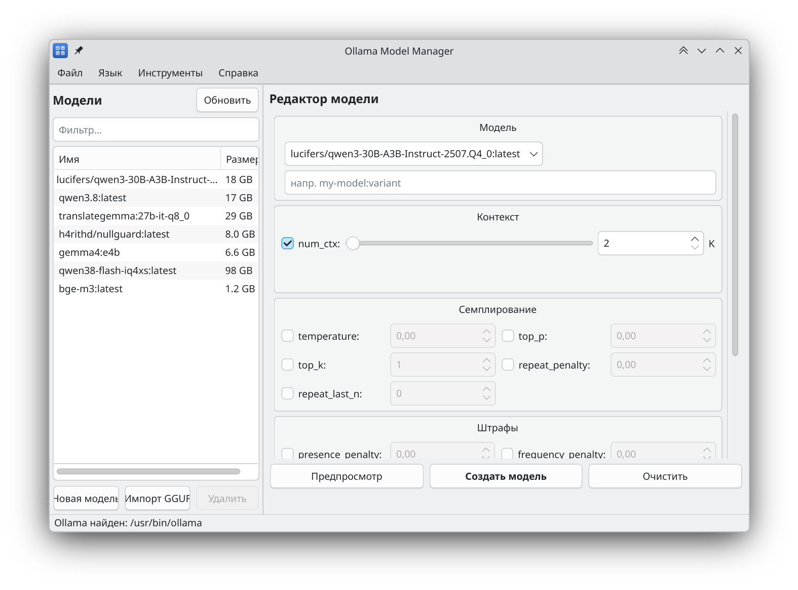
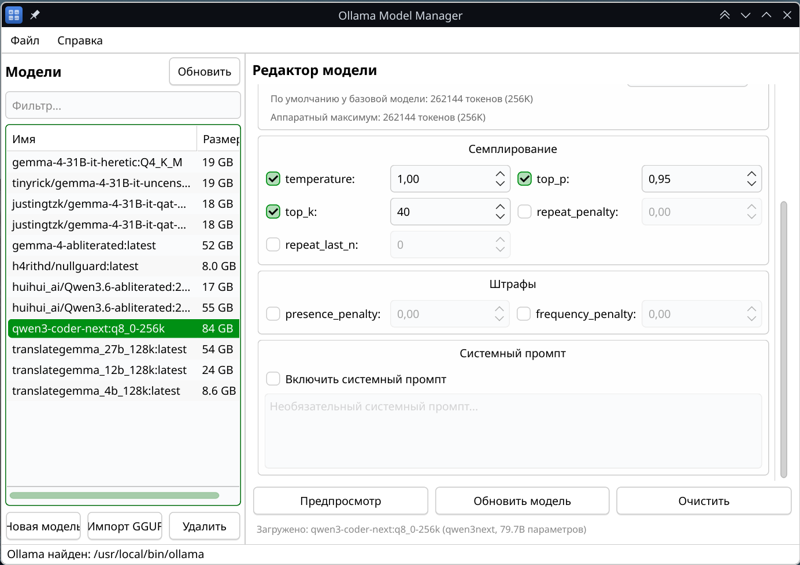
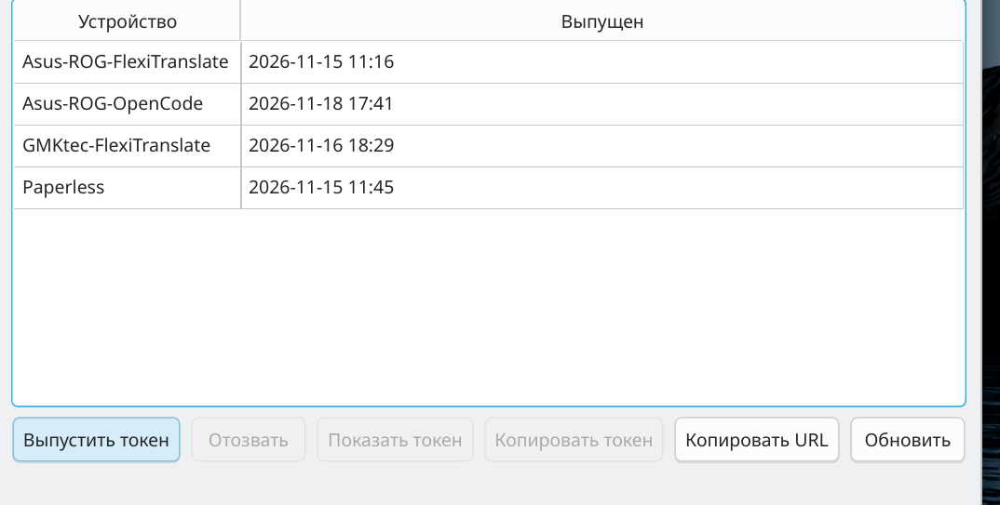
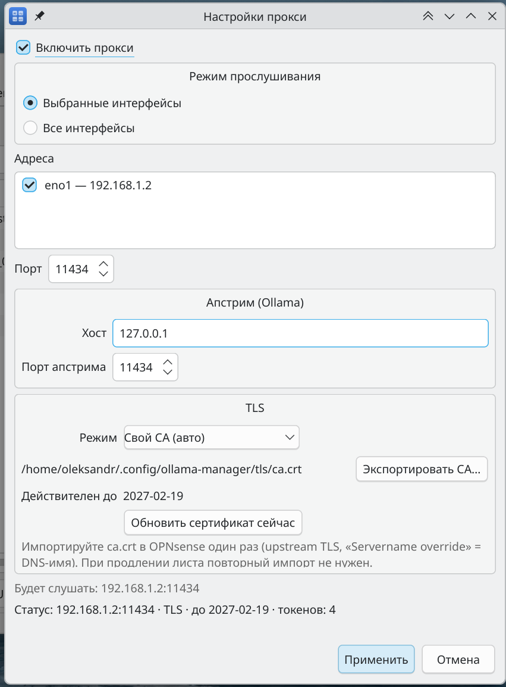

# Ollama Model Manager

[English](README.md) | **Русский**

Лёгкий настольный GUI для управления локальными моделями [Ollama](https://ollama.com) — на Qt 6 и C++17. Просматривайте установленные модели, меняйте параметры, создавайте варианты, импортируйте GGUF, переименовывайте и удаляйте без ручного `Modelfile`.

> **Главное:** редактирование модели сохраняет её мультимодальный (vision) проектор, шаблон, renderer и parser. Модель пересобирается по **имени**, поэтому `vision` и другие возможности не теряются молча.

## Скриншоты









## Возможности

- **Установленные модели карточками репозиториев**: кванты одного репозитория (Ollama или HuggingFace) в одной карточке; hero-строка с числом моделей, ОЗУ, диском blob'ов (`$OLLAMA_MODELS`, `/var/lib/ollama`, `~/.ollama/models`) и состоянием демона.
- **Редактор параметров** с подсказками: `num_ctx` (в K, с ползунком и потолком модели), `temperature`, `top_p`, `top_k`, `repeat_penalty`, `repeat_last_n`, `presence_penalty`, `frequency_penalty`, `SYSTEM` (дословно), другие кванты репозитория в списке FROM.
- **Создание / обновление моделей**: генерирует `Modelfile` и запускает `ollama create`, есть предпросмотр. При импорте GGUF читаются рекомендации `general.sampling.*`; иначе пишутся дефолты Ollama (`temperature 0.80`, `top_p 0.90`, `top_k 40`).
- **Переименование** (`ollama cp` + `rm`) и **удаление** с учётом общих blob'ов (предупреждение перед удалением последней ссылки).
- **Ollama**: поиск по ollama.com, теги с подсказкой «поместится в память», `ollama pull` с общим прогрессом, отметки установленного и обновлений.
- **HuggingFace**: GGUF-репозитории, по строке на квантизацию (split-GGUF и vision-проекторы), докачка с привязкой к коммиту, `ollama create` из скачанных файлов с последующим удалением, токен в KDE Wallet для gated-репозиториев.
- **Очередь и менеджер загрузок**: отдельные счётчики `O ↓ N` / `H ↓ N` в углу вкладок (серые при 0, синие при загрузке). Клик открывает список: активная задача сверху, очередь ниже, «Отмена» у каждой строки, приоритет перетаскиванием (бросить на активную — она стартует, прежняя встаёт за ней и продолжает с готовых blob'ов). Pull'ы Ollama идут по одному; HF-импорт имеет свою очередь и может идти параллельно.
- **Прерванные загрузки**: отмена HF-импорта удаляет `.part`; при обрыве они остаются в разделе **Незавершённые** с размером/процентом, «Продолжить» и «Удалить». Устаревшие `-partial` blob'ы Ollama (старше часа; целые модели не затрагиваются) чистятся через **Инструменты → Очистить недокачанные фрагменты Ollama…** (при нехватке прав — один `pkexec`).
- **Provenance** (`models.json`) и **Инструменты → Найти источники** для восстановления связи модели с репозиторием.
- **Импорт GGUF**, безопасные правки возможностей (проектор и шаблон наследуются), темы (system/light/dark), локализация `.ini` на лету.
- **API-токены + встроенный auth-прокси**: токен на устройство в KDE Wallet, проверка по SHA-256, отзыв сразу; флаг **Админ** разрешает pull/create/delete через прокси (`admin_api = restricted` по умолчанию).
- **Демон и трей**: фоновый режим с прокси в отдельном потоке; окно не блокирует удалённых клиентов во время запросов кошелька и генерации ключа.

## Требования

- Ollama в `PATH`
- Qt 6.5+ (Widgets, Core, Network; Test для тестов)
- KDE Frameworks 6 — KWallet (`KF6::Wallet`, `extra-cmake-modules`)
- CMake ≥ 3.21, OpenSSL CLI ≥ 3.0, компилятор C++17

Debian/Ubuntu: `sudo apt install build-essential cmake qt6-base-dev libkf6wallet-dev extra-cmake-modules`
Fedora: `sudo dnf install gcc-c++ cmake qt6-qtbase-devel kf6-kwallet-devel extra-cmake-modules`
Arch: `sudo pacman -S base-devel cmake qt6-base kwallet extra-cmake-modules`

## Сборка

```bash
git clone https://github.com/ur3ley/ollama-model-manager.git
cd ollama-model-manager
cmake -B build
cmake --build build
```

Бинарник: `build/ollama-model-manager`. Опции: `BUILD_TESTING` (ON), `OMM_DEV_TOOLS` (OFF), `OMM_WARNINGS_AS_ERRORS` (OFF). Установка: `sudo cmake --install build`.

## Использование

1. Вкладка **Установленные**: выберите модель, параметры загрузятся в редактор.
2. Меняйте параметры, **Предпросмотр** покажет `Modelfile`.
3. **Обновить** пересобирает модель на месте; новое имя + **Создать** — новый вариант.
4. **Ollama** / **HuggingFace** (`Ctrl+D`): поиск и установка. Загрузки встают в очередь по источникам; счётчики `O ↓ N` / `H ↓ N` открывают очередь с отменой и перестановкой.
5. **Импорт GGUF** (`Ctrl+I`).

Горячие клавиши: `Ctrl+N` новая · `Ctrl+I` импорт · `Ctrl+D` вкладки · `Ctrl+T` токены · `F5` обновить · `Ctrl+Q` выход.

### Где лежат файлы

| Что | Путь |
|---|---|
| Настройки | `~/.config/ollama-manager/config.ini` (0600) |
| Provenance | `~/.config/ollama-manager/models.json` |
| TLS прокси | `~/.config/ollama-manager/tls/` (0700) |
| Скачанные GGUF | `~/.local/share/ollama-manager/models` (удаляются после импорта) |
| Секреты | KDE Wallet: `ollama-auth` / `ollama-model-manager` |

## Встроенный auth-прокси

Режимы: выбранные интерфейсы (порт может совпадать с Ollama, `11434`) или все интерфейсы (`0.0.0.0`, порт должен отличаться). Loopback не занимается — локальные клиенты работают напрямую. Стриминг сохраняется байт-в-байт. TLS: внутренний CA (10 лет, листовой сертификат на 90 дней с автопродлением), свои файлы или Let's Encrypt. Подробности и откат — [`docs/proxy.md`](docs/proxy.md).

Токены: 24 случайных байта → 48 hex; в кошельке `<device>`, `created:<device>`, `admin:<device>`. Выпуск/отзыв — **Инструменты → API-токены…**.

## Тесты

```bash
cmake -B build && cmake --build build
ctest --test-dir build --output-on-failure
```

15 оффлайн-тестов (изолированный `HOME`, offscreen): прокси, задания `ollama`, HF-загрузка с локального HTTP, миграции, парсеры, GGUF, provenance, smoke-тесты виджетов. `token-selftest` — вручную (нужен открытый KDE Wallet); `discoverpanel-selftest --live/--pull/--queue` — сеть.

## Локализация

Тексты — в `languages/<code>.ini`, английский (`en.ini`) — база и fallback. Новый язык добавляется копированием `en.ini` и переводом значений; пересборка не нужна. См. [`languages/_HOWTO.txt`](languages/_HOWTO.txt).

## Ограничения

- **Аудио не поддерживается**: Ollama подключает только проекторы изображений (CLIP-стиль).
- `think` / уровень рассуждений нельзя задать через `Modelfile` — только `ollama run --think` или API.
- Пути к blob'ам предполагают стандартную раскладку Ollama (`/var/lib/ollama/blobs`).

## Лицензия

MIT (см. [LICENSE](LICENSE)). Приложение линкуется с Qt 6 (GNU LGPL v3); при распространении бинарника соблюдайте условия LGPL Qt.

## Участие

Issues и pull requests приветствуются; сохраняйте стиль Qt/C++17 и описывайте мотивацию изменений.
